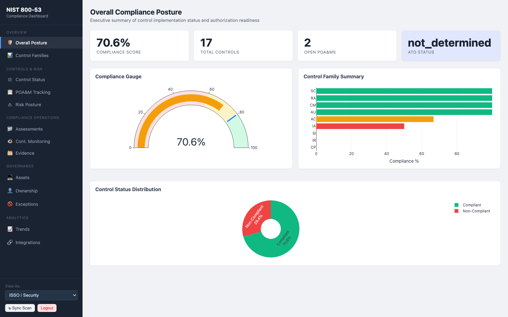
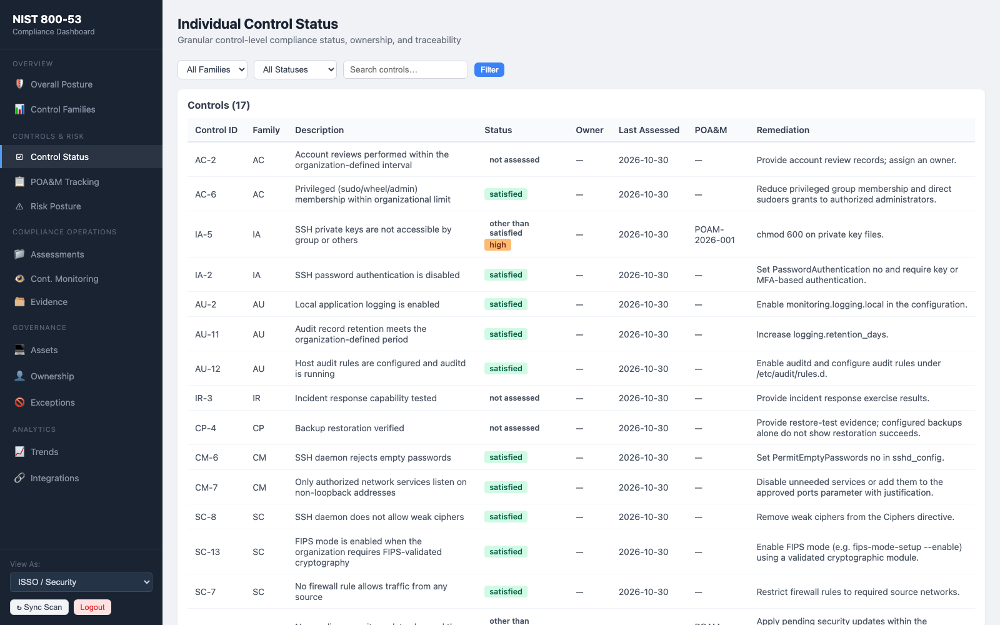
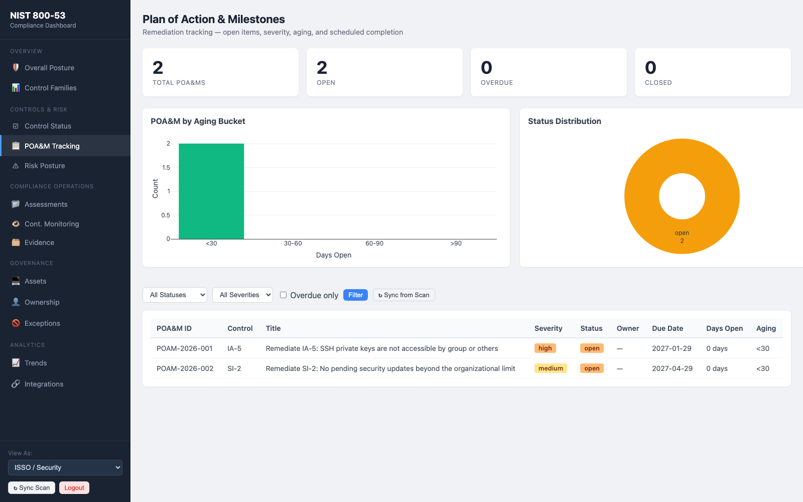
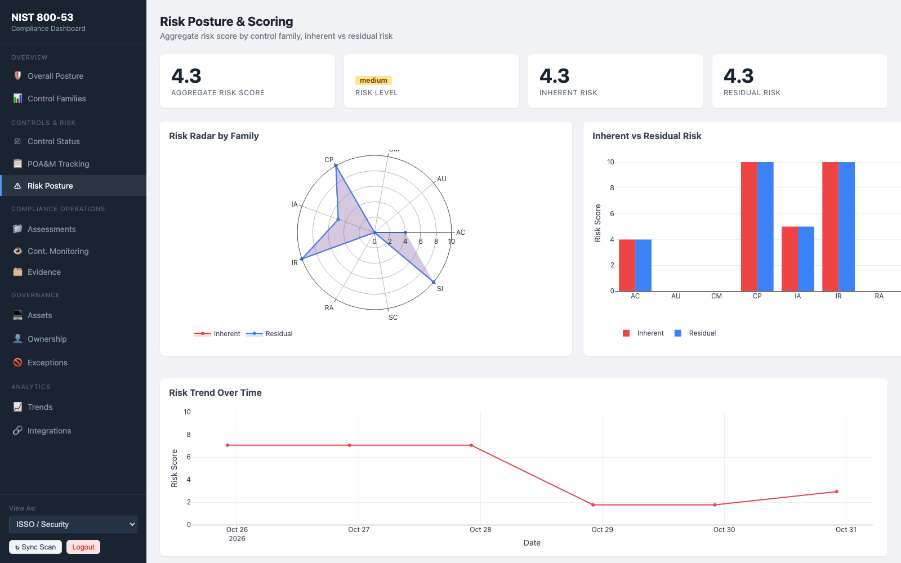

# NIST 800-53 Compliance Scanner

> Evidence-driven NIST 800-53 Rev. 5 assessment engine: collects read-only evidence, evaluates it with versioned policy-as-code rules, and reports honest per-objective states and OSCAL output. Early-stage — see "Assessment model" for what is and is not covered.

[](https://www.python.org/) [](https://www.docker.com/) [](https://grafana.com/) [](https://csrc.nist.gov/publications/detail/sp/800-53/rev-5/final) [](https://www.fedramp.gov/) [](https://opensource.org/licenses/MIT)

---

## Overview

1. Collects evidence (Linux host state, configured AWS/Azure/GCP IAM, Windows local policy, and imported firewall/vulnerability reports) and evaluates it against rules in `rules/`. Coverage is a small, explicit set of controls; everything else is reported as `not_assessed`, never as compliant. See [docs/ASSESSMENT_MODEL.md](docs/ASSESSMENT_MODEL.md).
2. Produces Markdown, JSON, and OSCAL (assessment-results, plus POA&M when findings are open) reports with per-objective status (satisfied / other than satisfied / not assessed / not applicable), evidence references, and remediation guidance.
3. Exposes Prometheus metrics from the Flask dashboard and provisions a Grafana overview dashboard via configuration-as-code.
4. Enforces alert rules through `alert_rules.yml` so teams receive notifications when compliance posture drops below defined thresholds.
5. Supports multi-tenant operation, rate limiting, encrypted storage of scan results, and OpenTelemetry distributed tracing for production-grade observability.
6. Provides startup and shutdown lifecycle scripts, a suite of example configurations, and a POA&M generator for tracking remediation of non-compliant controls.

---

## Dashboard

The Flask dashboard in `dashboard/` reads assessment reports from `reports/` and presents the evidence-driven model: per-control status, evidence, POA&M tracking, risk, and trends. It deliberately shows `ATO status: not_determined` — authorization is a human decision, not a scanner output.

The screenshots below were captured from the running dashboard using the bundled synthetic demo data (`python scripts/generate_demo_reports.py`). The demo uses the `rules` baseline (17 rule-covered controls); a default moderate-baseline scan has 287 controls in the denominator and therefore much lower coverage (see [Coverage](#coverage)).



*Overall posture: 70.6% of the 17 rule-covered controls, 2 open POA&M items, and no automated ATO decision.*



*Control status: satisfied / other-than-satisfied / not-assessed / not-applicable, with POA&M linkage and remediation text.*



*POA&M tracking: auto-generated from open findings, with severity, due date, and aging.*



*Risk posture: family risk radar, inherent vs residual comparison, and trend from report history.*

More view: [control family breakdown](docs/images/dashboard-families.png).

### Run the dashboard

```bash
# 1. Install dependencies and configure (see Quick Start)
# 2. Optional: generate synthetic reports so the dashboard has data.
#    This is offline and uses stub collectors; no host or cloud access.
python scripts/generate_demo_reports.py --days 6

# 3. Start the dashboard. Default port is 5001; DASHBOARD_PORT overrides it.
DASHBOARD_PORT=8000 python dashboard/app.py

# 4. Open the UI and sign in with the development credentials:
#    http://127.0.0.1:8000/login   (admin / password)
# 5. Open POA&M Tracking and click "Sync from Scan" to create POA&M items
#    from the latest report (the posture "Open POA&Ms" card updates too).
```

The dashboard reads every `*.json` report in `reports/` (gitignored). Real scans write a versioned, encrypted report there automatically, so the dashboard shows the latest completed scan without extra steps. `python scan.py --format json` also writes a plaintext report in the current directory; copy it into `reports/` if you want the dashboard to read it directly.

> Development-only authentication: the default login is hardcoded to `admin` / `password`. Replace it with your own identity provider or local user store before exposing the dashboard beyond localhost. See `dashboard/config/development.yaml` and `dashboard/config/production.yaml`.

---

## Architecture

```text
config.yaml        rules/*.yaml        parameters.yaml
     |                  |                    |
     +------------------+--------------------+
                        |
                        v
              engine.runner.run_assessment
                 collect -> evaluate
                        |
        +---------------+----------------+
        |                                |
        v                                v
Collectors (read-only)               Rule evaluator
- Linux: accounts, sshd (+Include),  - policy-as-code expressions
  SSH keys, auditd, sysctl,          - organizational parameters
  listeners, FIPS, patches           - exceptions / applicability
- AWS / Azure / GCP IAM              - parameters override evidence
- Windows local (SID + secedit)
- imported firewall / vuln reports
        |                                |
        v                                v
Evidence (hash covers full       Assessments
observation, incl. method)       satisfied | other than satisfied |
                                 not_assessed | not_applicable
                                         |
             +---------------------------+---------------------------+
             v                           v                           v
     Markdown / JSON              OSCAL 1.1.2                    Dashboard
                                  assessment-results + POA&M     Flask + Prometheus
                                                                 reports/*.json
```

A scan is deliberately split into **evidence collection** and **evaluation**. Collectors never judge compliance; the evaluator cannot invent evidence. Missing, stale, unreadable or errored evidence becomes `not_assessed`, never a pass.

---

## Key Features

### Coverage

Coverage is measured against a published NIST SP 800-53 Rev. 5 baseline, not against the rules that happen to exist. The default is the Moderate baseline (287 controls including enhancements). The shipped ruleset currently has **30 rules (27 automated) covering 17 controls**:

`AC-2`, `AC-3`, `AC-6`, `AU-2`, `AU-11`, `AU-12`, `CM-6`, `CM-7`, `CP-4`, `IA-2`, `IA-5`, `IR-3`, `RA-5`, `SC-7`, `SC-8`, `SC-13`, `SI-2`.

Everything else in the baseline is reported as `not_assessed`, never as compliant. Enhancements are separate controls: a rule on `AC-2` does not cover `AC-2.1`. Use `--baseline low|moderate|high|all|rules` to choose the denominator; `--baseline rules` limits it to the 17 controls above (the dashboard demo uses this so screenshots focus on implemented checks).

| Baseline | Controls (catalog 5.2.0) |
| --- | --- |
| `low` | 149 |
| `moderate` (default) | 287 |
| `high` | 370 |
| `all` | 1,196 |

### What is covered

| Evidence | Collector | Example assessed controls |
| --- | --- | --- |
| Linux accounts + lastlog | `linux.accounts` | AC-2 (inactive accounts), AC-6 (privileged membership) |
| sshd config, including `Include` files | `linux.sshd_config` | AC-6, IA-2, CM-6, SC-8 |
| SSH private-key modes | `linux.ssh_keys` | IA-5 |
| auditd rules and running state | `linux.audit` | AU-12 |
| sysctl, listeners, FIPS, package index | `linux.*` | CM-6, CM-7, SC-13, SI-2 |
| Scanner logging configuration | `app.logging_config` | AU-2, AU-11 |
| Firewall exports | `network.firewall_rules` | SC-7 |
| Imported vulnerability report | `vuln.scan_report` | RA-5 |
| AWS / Azure / GCP IAM | `aws.iam`, `azure.directory`, `gcp.iam` | AC-2, AC-3, AC-6, IA-2 |
| Windows local policy | `windows.accounts` | AC-6, IA-5 |

Collector notes:

- Evidence is hashed over the full observation (type, asset, collector, method, payload, timestamp); imported firewall/vulnerability exports also include their file SHA-256.
- An unreadable file or host, a stale package index, an unknown auditd state, or a missing sshd include is a coverage gap (`not_assessed`), not a pass.
- Cloud IAM: AWS honors `static`, `assume_role` or ambient credentials; GCP evaluates the **project-level** policy only (inherited folder/org bindings are not included); Windows local password policy is `not_assessed` on domain-joined hosts.
- The older `modules/*Scanner` classes (including SSH/WinRM and the previous cloud scanners) are not invoked by `scan.py`; they remain in the tree for reference and dashboard history. The supported scan path is `engine/` + `rules/`.

### Observability Stack

The Flask application in `dashboard/` exposes Prometheus metrics at `GET /metrics` and a JSON posture endpoint at `GET /api/v2/posture`. Grafana is provisioned automatically from `grafana/provisioning/` and `grafana/dashboards/`.

Exported metric series (prefix `nist_dashboard_`):

- `nist_dashboard_compliance_pct` — overall compliance percentage
- `nist_dashboard_controls_total`, `nist_dashboard_controls_compliant`, `nist_dashboard_controls_non_compliant`
- `nist_dashboard_poam_open`, `nist_dashboard_poam_critical_open`
- `nist_dashboard_family_compliance_pct{family="AC"}` (one series per NIST family)
- `nist_dashboard_data_available` — 1 when scan results are loaded, 0 otherwise
- `nist_dashboard_latest_report_info` — info metric with `report_id` and `last_scan_date` labels

### Automated Alerting

Alert rules in `alert_rules.yml` integrate with Prometheus Alertmanager to notify teams when:

- Overall compliance percentage falls below configured thresholds
- Critical POA&M items remain open beyond their scheduled remediation dates
- Scan data becomes unavailable or stale

### Reporting and POA&M

- Markdown, JSON, and OSCAL output via `scan.py --format markdown|json|oscal`
- Report versioning via `modules/report_versioning.py` tracks history over time
- `dashboard/poam_generator.py` produces Plan of Action and Milestones documents for non-compliant controls, supporting FedRAMP continuous monitoring requirements

### Security and Compliance

- NIST 800-53 Rev. 5 — Low, Moderate, and High impact baselines
- FedRAMP Moderate alignment (see `docs/fedramp-baseline.md`)
- AWS Config conformance pack mapping (50+ rules documented in `docs/aws-config-mapping.md`)
- AES-256-GCM encryption for scan results at rest; TLS 1.3 for data in transit
- API key authentication with rotation policy, rate limiting per IP and per key
- OpenTelemetry distributed tracing with OTLP export
- CI runs Bandit, Ruff and mypy; the repository currently has known lint/type debt, so these are not yet a clean gate
- Secrets baseline managed via detect-secrets (`.secrets.baseline`)

---

## Quick Start

### Prerequisites

- Python 3.12 or later
- Linux host access for host collectors (some checks read `/etc/ssh`, auditd, `/root/.ssh` and `lastlog`; run as root for complete evidence), or Windows for the local Windows collector
- Cloud provider credentials only if the AWS/Azure/GCP collectors are enabled in the config
- Docker and Docker Compose for the containerized stack (optional)
- The current scan path is local-host + configured cloud IAM; the legacy SSH/WinRM remote-host scanners are not invoked by `scan.py`

### Local Development

```bash
# Clone the repository
git clone https://github.com/dbsectrainer/nist_800_53_scanner.git
cd nist_800_53_scanner

# Create and activate a virtual environment
python -m venv venv
source venv/bin/activate

# Install dependencies
pip install -r requirements.txt
pip install -r requirements-dev.txt   # tests and linting

# Copy and edit the configuration
cp config_examples/basic_config.yaml config.yaml
# Edit config.yaml to supply cloud credentials and scan targets

# Run a scan and write a Markdown report
python scan.py --config config.yaml

# OSCAL assessment-results (and POA&M if findings are open)
python scan.py --config config.yaml --format oscal

# Choose the control universe used for coverage (default: moderate baseline)
python scan.py --config config.yaml --baseline high

# Point at custom policy/rules (required when running from an installed wheel,
# which does not ship the repository's rules/ directory)
python scan.py --config config.yaml --rules-dir ./rules --parameters ./parameters.yaml

# Optional: generate synthetic reports for the dashboard (offline, no host/cloud access)
python scripts/generate_demo_reports.py --days 6

# Start the dashboard and open http://127.0.0.1:8000/login
DASHBOARD_PORT=8000 python dashboard/app.py
```

The dashboard reads every `*.json` report in `reports/` (gitignored). A real scan writes a versioned encrypted report there automatically; the demo script writes synthetic plaintext reports. The default development login is `admin` / `password` — development only.

### Docker Deployment

```bash
# Start the full observability stack (scanner, dashboard, Prometheus, Grafana)
docker-compose up -d
```

| Service | URL | Notes |
| --- | --- | --- |
| Compliance Dashboard | http://localhost:8000 | Web UI; `/dashboard` requires login (dev: `admin` / `password`) |
| Prometheus | http://localhost:9090 | Scrapes `nist_compliance_scanner:8000/metrics` |
| Grafana | http://localhost:3000 | Default credentials `admin` / `admin` — change `GF_SECURITY_ADMIN_PASSWORD` before any non-local use |

```bash
# Use lifecycle scripts
./startup.sh    # start services
./shutdown.sh   # stop services

# Run without Docker
export DASHBOARD_PORT=8000
python dashboard/app.py
curl -s http://127.0.0.1:8000/metrics | head
```

Security note: expose `/metrics` only on trusted networks. For production, terminate TLS on a reverse proxy and restrict access to Prometheus and the scrape port.

---

## Project Status

**Early-stage.** The collect → evaluate → report engine under `engine/` is the supported scan path. The older `modules/*Scanner` classes (including the previous cloud and SSH/WinRM helpers) are not run by `scan.py`; porting their checks to collectors and rules is planned.

- 30 rules (27 automated) covering 17 controls, evaluated against a published baseline; uncovered controls are always `not_assessed`
- Evidence hashes, staleness, collectors errors, and unreadable inputs are handled explicitly; see [docs/ASSESSMENT_MODEL.md](docs/ASSESSMENT_MODEL.md)
- OSCAL 1.1.2 assessment-results and POA&M export, validated against the NIST schemas
- Flask dashboard with control status, family breakdown, POA&M tracking, risk, trends, and Prometheus metrics; screenshots above
- Report versioning, POA&M generation, encrypted report storage, and multi-tenant scaffolding
- 295 tests (engine, dashboard/data integration, collectors, rules, catalog coverage, OSCAL schemas, and legacy modules)
- Docker Compose stack for the full local stack
- GitHub Actions runs Ruff, mypy, Bandit, and the test suite; the repository currently has pre-existing lint/type debt, so those checks are not yet a clean gate

### Verification

```bash
# Install dependencies and run the suite
pip install -r requirements.txt
pip install -r requirements-dev.txt
python -m pytest tests/ -q          # 295 passed at the time of writing

# Regenerate the dashboard demo data, then start the UI
python scripts/generate_demo_reports.py --days 6
DASHBOARD_PORT=8000 python dashboard/app.py
# open http://127.0.0.1:8000/login   (admin / password — development only)

# Verify the metrics endpoint and posture API
curl -s http://127.0.0.1:8000/metrics | grep nist_dashboard
curl -s -c cookies.txt -H 'Content-Type: application/json' \
  -d '{"username":"admin","password":"password"}' http://127.0.0.1:8000/login >/dev/null
curl -s -b cookies.txt http://127.0.0.1:8000/api/v2/posture
```

The dashboard's posture endpoint should report `ato_status: not_determined`; the scanner supplies evidence, not an authorization decision.

## Project Structure

```text
nist_800_53_scanner/
├── scan.py                        # CLI: collect -> evaluate -> report
├── engine/                        # Supported assessment engine
│   ├── collectors/                # read-only Linux/cloud/Windows/import collectors
│   ├── data/rev5_control_ids.json # pinned Rev. 5 control IDs and baselines
│   ├── models.py                  # Evidence / Assessment / Status model
│   ├── runner.py                  # orchestrates collect -> evaluate
│   ├── evaluate.py                # rule x evidence -> assessment
│   ├── expr.py                    # safe, deterministic expression evaluator
│   ├── rules.py                   # rule/policy loading, parameters, exceptions
│   ├── coverage.py                # coverage and roll-up metrics
│   ├── oscal.py                   # OSCAL assessment-results / POA&M
│   └── catalog.py                 # baseline sizes and pinned catalog fetch
├── rules/                         # policy-as-code rules (30 rules, 17 controls)
├── parameters.yaml                # organization parameters, exceptions, N/A decisions
├── reports/                       # dashboard input (gitignored)
├── dashboard/                     # Flask dashboard + Prometheus metrics
│   ├── app.py, data_manager.py, models.py, poam_generator.py
│   ├── config/                    # dashboard environment configs
│   ├── static/                    # CSS/JS assets
│   └── templates/                 # HTML templates
├── docs/
│   ├── ASSESSMENT_MODEL.md        # statuses, rules, coverage, collector limitations
│   └── images/                    # dashboard screenshots used above
├── scripts/
│   └── generate_demo_reports.py   # offline synthetic reports for the dashboard
├── modules/                       # legacy scanners/utilities (not run by scan.py)
├── tests/                         # unit + integration tests (tests/engine/ for the engine)
├── grafana/                       # Grafana provisioning and dashboards
├── prometheus.yml, alert_rules.yml
├── Dockerfile, docker-compose.yml, startup.sh, shutdown.sh
└── requirements.txt, requirements-dev.txt, pyproject.toml
```

## BE EASY ENTERPRISES Federal Portfolio

| Showcase Project | Repository | Description |
| --- | --- | --- |
| **Secure RAG Pipeline** | [Secure-Generative-AI-Platform-on-AWS](https://github.com/dbsectrainer/Secure-Generative-AI-Platform-on-AWS) | AWS Bedrock + RAG with FedRAMP High alignment |
| **DevSecOps CI/CD** | [dod-cybersec-ops-framework](https://github.com/dbsectrainer/dod-cybersec-ops-framework) | DoD 8570 / NIST RMF aligned pipeline |
| **Zero Trust Architecture** | [AEGIS](https://github.com/dbsectrainer/AEGIS) | FedRAMP High + NIST 800-207 Zero Trust |
| **FedRAMP Control Automation** | **[nist_800_53_scanner](https://github.com/dbsectrainer/nist_800_53_scanner)** | **This repo** |
| **Federal AI Governance** | [ai-safety-governance](https://github.com/dbsectrainer/ai-safety-governance) | EO 14110 / OMB M-24-10 aligned |
| **CMMC 2.0 Dashboard** | [integrated-cyber-risk-compliance](https://github.com/dbsectrainer/integrated-cyber-risk-compliance) | CMMC 2.0 readiness assessment |
| **FedRAMP 30-Day Guide** | [cloud-security-best-practices](https://github.com/dbsectrainer/cloud-security-best-practices) | Day-by-day FedRAMP implementation roadmap |
| **Agentic AI Workflow** | [federal-doc-triage-agent](https://github.com/dbsectrainer/federal-doc-triage-agent) | Production-ready LangGraph + Bedrock triage agent |

---

## Author

**Donnivis Baker** — [github.com/dbsectrainer](https://github.com/dbsectrainer)
**BE EASY ENTERPRISES** — Federal IT Modernization & Cybersecurity

For questions, partnerships, or federal engagement inquiries, open an issue or reach out directly.

**Document Version:** 1.1 | **Last Updated:** 2026-10-31 | **NIST 800-53 Rev. 5:** Moderate Baseline
